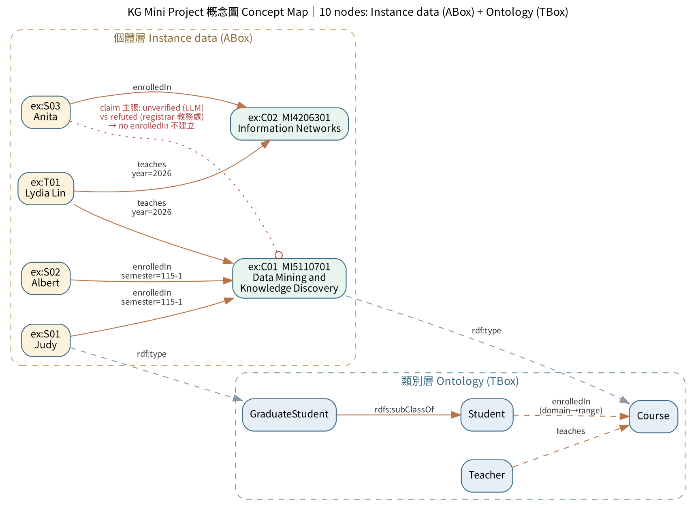

# KG Mini Project — 修課知識圖譜（RDF ＋ Property Graph）<br>Course Enrollment Knowledge Graph (RDF + Property Graph)

對應《Knowledge Graph Fundamentals》2026 本週講義第 23 頁 Mini Project：以**同一份 CSV** 交付兩種資料模型的小型 KG，附 ontology、查詢、SHACL 驗證與自動測試。

The Mini Project from page 23 of the *Knowledge Graph Fundamentals* (2026) handout: a small KG built from **one set of CSV files** in two data models, with an ontology, queries, SHACL validation and automated tests.



*概念圖：上方為個體層（ABox）事實，下方為類別層（TBox）ontology；紅色虛線為未確認、互相衝突的修課主張，刻意不建立 `enrolledIn`。*
*Concept map: instance-level facts (ABox) on top, the ontology (TBox) below. The red dotted edge is an unverified, conflicting enrollment claim that is deliberately **not** turned into `enrolledIn`.*

---

## 資料內容 Data at a glance

| 內部 ID<br>Internal ID | 課程號碼<br>Course no. | 課名<br>Title | 授課<br>Teacher | 修課學生<br>Students |
|---|---|---|---|---|
| C01 | MI5110701 | Data Mining and Knowledge Discovery | Lydia Lin | Judy (S01, graduate), Albert (S02) |
| C02 | MI4206301 | Information Networks | Lydia Lin | Anita (S03) |

---

## 快速開始 Quick start

```bash
pip install -r requirements.txt
python build_kg.py     # 建圖、查詢、推論、驗證，產出 out/ ｜ build, query, infer, validate → out/
pytest -v              # 25 項測試，依評分面向分組並含反例 ｜ 25 tests grouped by rubric, with negative cases
```

預期輸出（節錄）Expected output (excerpt):

```
== SPARQL：選 C01 的學生 ==            ← students enrolled in C01
  S01  Judy
  S02  Albert
== 推論：ex:S01 a ex:Student ? True（推論前 False）   ← inferred via GraduateStudent ⊑ Student
== SHACL 驗證通過：True                ← SHACL conforms
```

---

## 套件與工具 Requirements

### Python 套件 Python packages（`requirements.txt`）

| 套件 Package | 用途 | Purpose | 官網 Official site |
|---|---|---|---|
| **rdflib** ≥ 7.0 | 建立 RDF 圖、輸出 Turtle、執行 SPARQL 查詢 | Build RDF graphs, serialize Turtle, run SPARQL | [rdflib.readthedocs.io](https://rdflib.readthedocs.io/) · [GitHub](https://github.com/RDFLib/rdflib) |
| **pySHACL** ≥ 0.26 | 以 `shapes.ttl` 驗證資料、回報違規 | Validate data against `shapes.ttl` and report violations | [GitHub](https://github.com/RDFLib/pySHACL) |
| **OWL-RL** ≥ 6.0 | RDFS 推論（例如 GraduateStudent ⊑ Student） | RDFS reasoning (e.g. GraduateStudent ⊑ Student) | [owl-rl.readthedocs.io](https://owl-rl.readthedocs.io/) · [GitHub](https://github.com/RDFLib/OWL-RL) |
| **NetworkX** ≥ 3.0 | 在 Python 中模擬 Labeled Property Graph | Simulate the labeled property graph in Python | [networkx.org](https://networkx.org/) |
| **pytest** ≥ 8.0 | 執行自動測試 | Run the automated tests | [pytest.org](https://docs.pytest.org/) |

已測試版本 Tested with: Python 3.13、rdflib 7.6.0、pySHACL 0.40.1、OWL-RL 7.6.2、NetworkX 3.7、pytest 9.1.1。

### 選用工具 Optional tools

| 工具 Tool | 用途 | Purpose | 官網 Official site |
|---|---|---|---|
| **Neo4j** 5.x | 在真實圖資料庫執行 `out/load.cypher` | Run `out/load.cypher` in a real graph database | [neo4j.com](https://neo4j.com/) · [Docker image](https://hub.docker.com/_/neo4j) |
| **Docker** | 在本機啟動 Neo4j 容器 | Run Neo4j locally in a container | [docker.com](https://www.docker.com/) |
| **Graphviz** | 由 `concept_map.dot` 重新產生概念圖 | Re-render the concept map from `concept_map.dot` | [graphviz.org](https://graphviz.org/) |

相關標準 Related W3C standards: [RDF 1.1](https://www.w3.org/TR/rdf11-concepts/) · [RDF Schema](https://www.w3.org/TR/rdf-schema/) · [OWL 2](https://www.w3.org/TR/owl2-overview/) · [SPARQL 1.1](https://www.w3.org/TR/sparql11-query/) · [SHACL](https://www.w3.org/TR/shacl/)

---

## 檔案 Files

| 檔案 File | 內容 | Contents | 講義頁 Page |
|---|---|---|---|
| `data/*.csv` | 學生、課程、修課、授課、主張（刻意含髒資料） | Students, courses, enrollments, teaching, claims (dirty data on purpose) | 16 |
| `ontology.ttl` | TBox：類別、屬性與語意 | TBox: classes, properties, semantics | 14–15, 21 |
| `shapes.ttl` | SHACL 驗證規則 | SHACL validation shapes | 21–22 |
| `build_kg.py` | CSV→RDF／LPG／Cypher、SPARQL、推論、驗證 | CSV→RDF/LPG/Cypher, SPARQL, reasoning, validation | 16, 19–21 |
| `test_kg.py` | 依評分規準組織的測試 | Tests organized by grading rubric | 22–23 |
| `concept_map.dot` | 概念圖原始檔 | Concept map source | 23 |
| `out/kg.ttl` | 產出的 Turtle（ABox） | Generated Turtle (ABox) | 20 |
| `out/load.cypher` | Neo4j 匯入、驗證、查詢腳本 | Neo4j load, check and query script | 19 |
| `out/mapping_report.json` | 被拒或重複的資料列 | Rejected and duplicate rows | 16, 18 |
| `out/concept_map.png` / `.svg` | 概念圖 | Concept map | 23 |

---

## 繳交物對照 Deliverables checklist（p. 23）

| 要求 Requirement | 本專案 This project |
|---|---|
| 5–10 節點概念圖<br>Concept map, 5–10 nodes | `out/concept_map.png`：4 類別 ＋ 6 個體 ＝ 10<br>4 classes + 6 instances = 10 |
| 五筆 RDF triples<br>Five RDF triples | `S01 a GraduateStudent`、`S02 a Student`、`C01 a Course`、`S01 enrolledIn C01`、`S02 enrolledIn C01`（`out/kg.ttl` 共 50+ 筆 / 50+ in total） |
| ≥ 3 LPG 節點、2 關係<br>≥ 3 LPG nodes, 2 relationships | S01、S02、C01 ＋ 兩條 `ENROLLED_IN {semester}` |
| 簡要 ontology<br>A brief ontology | `ontology.ttl` |
| 兩條查詢<br>Two queries | SPARQL 與 Cypher「選 C01 的學生」→ Judy、Albert<br>SPARQL and Cypher "students in C01" → Judy, Albert |

### 評分面向 Rubric → 測試 Tests

| 面向 Dimension | 比重 Weight | 測試內容 What is tested |
|---|---|---|
| 模型正確性 Model correctness | 40% | 核心 triples、姓名為 literal、只有一個 C01 節點、邊的方向、RDF 與 LPG 一致<br>Core triples, names are literals, one C01 node, edge direction, RDF ≡ LPG |
| 語意與識別碼 Semantics & IDs | 25% | ID 去空白、subClassOf 推論、課號格式；反例：姓名寫成 IRI、物件是老師、反向邊、重複課程<br>ID trimming, subclass inference, course number format; negatives: name as IRI, teacher as object, reversed edge, duplicate course |
| 查詢 Queries | 20% | SPARQL、LPG 查詢、Cypher 腳本（constraint 先於匯入）<br>SPARQL, LPG query, Cypher script (constraints before load) |
| 證據與追溯 Evidence & provenance | 15% | 每筆可追回 CSV 列號、壞資料有記錄、未確認主張不升級為事實<br>Every fact traces to a CSV row, bad rows logged, unverified claims never become facts |

---

## CSV → KG Mapping（p. 16）

| 來源欄位 Source | 目標 Target | 轉換規則 Rule |
|---|---|---|
| `students.student_no` | `Student.id` / `ex:{id}` | 去除空白、驗證唯一<br>Trim whitespace, check uniqueness |
| `students.name` | `ex:name` / `s.name` | `"…"@en` 語言標記 literal<br>Language-tagged literal |
| `students.level` | `rdf:type` / 額外 label | `graduate` → `GraduateStudent` |
| `courses.course_code` | `Course.id` / `ex:{id}` | 穩定的內部 ID<br>Stable internal ID |
| `courses.course_no` | `ex:courseNumber` / `c.course_no` | 學校課號，SHACL 檢查格式（如 MI5110701）<br>Official course number, format checked by SHACL |
| `courses.title` | `rdfs:label` / `c.title` | `"…"@en` |
| `enrollment(student_no, course_code, semester)` | `ex:enrolledIn` ＋ `ex:Enrollment`；LPG `[:ENROLLED_IN {semester}]` | ID 無法對應或空值 → 拒收並記錄；同學期同課 → 重複<br>Unknown ID or blank → rejected and logged; same course + semester → duplicate |
| `enrollment.recorded_on` ＋ 列號 row no. | `ex:recordedOn`、`ex:sourceFile`、`ex:sourceRow` | 可逐筆追回原始列<br>Every fact traces back to its source row |
| `teaching.csv` | `ex:teaches` / `[:TEACHES {year}]` | 一位老師可授多門課，老師節點不重複<br>One teacher, many courses, one Teacher node |
| `claims.csv` | `ex:EnrollmentClaim {status, source}` | **不**升級為 `enrolledIn`<br>**Never** promoted to `enrolledIn` |

資料清理結果：拒收 2 列（學號 S09 不存在、course_code 空白）、重複 1 列，皆寫入 `mapping_report.json`。
Cleaning result: 2 rows rejected (unknown student S09, blank course code) and 1 duplicate, all logged in `mapping_report.json`.

---

## 建置過程中踩到的兩個坑 Two pitfalls found while building（p. 21）

**1. `rdfs:domain` 會推論，不會拒絕 ｜ `rdfs:domain` infers, it does not reject**

第一版把 `ex:student` 的 domain 設為 `ex:Enrollment`，結果 RDFS 推論把兩筆「未確認的修課主張」推成確定的 `Enrollment`。修法：被多種類別共用的屬性不宣告 domain。`test_claims_not_inferred_as_enrollment` 防止回歸。

The first version declared `rdfs:domain ex:Enrollment` on `ex:student`, so RDFS reasoning silently turned both unverified claims into confirmed enrollments. Fix: don't declare a domain on properties shared by several classes. `test_claims_not_inferred_as_enrollment` guards against regression.

**2. 先推論再驗證，錯誤會被洗白 ｜ Inferring before validating hides errors**

若 SHACL 以 `inference="rdfs"` 執行，`ex:S01 ex:enrolledIn ex:T01`（物件是老師）會先因 `rdfs:range ex:Course` 被推成 `T01 a Course`，`sh:class` 檢查就通過了。修法：對原始資料驗證（`inference="none"`），並用 `sh:targetSubjectsOf ex:enrolledIn` 檢查方向。

With `inference="rdfs"`, the bad triple `ex:S01 ex:enrolledIn ex:T01` (a teacher as object) is first inferred as `T01 a Course` through `rdfs:range`, so the `sh:class` check passes. Fix: validate the raw data (`inference="none"`) and check edge direction with `sh:targetSubjectsOf ex:enrolledIn`.

---

## 衝突證據的處理 Handling conflicting evidence（p. 23）

Anita（S03）是否修 C01 有兩個來源：LLM 從會議紀錄擷取（`unverified`）與教務處匯出（`refuted`）。兩筆都保留為 `EnrollmentClaim`，各自帶 `status`、`source`、`recordedOn`；**不**寫成 `S03 enrolledIn C01`，也不刪掉任何一筆。查詢確定修課時只走 `enrolledIn`，稽核時查 Claim 節點。

Two sources disagree on whether Anita (S03) takes C01: an LLM extraction from meeting notes (`unverified`) and the registrar export (`refuted`). Both are kept as `EnrollmentClaim` nodes with `status`, `source` and `recordedOn`. Neither is written as `S03 enrolledIn C01`, and neither is deleted. Confirmed enrollments are queried through `enrolledIn`; claims are kept for auditing.

---

## 在 Neo4j 上執行 Running on Neo4j

以 Docker 啟動一個不需密碼的本機 Neo4j（僅供本機練習）：
Start a local Neo4j with authentication disabled (local practice only):

```bash
docker run -d --name kg-mini-neo4j \
  -p 7475:7474 -p 7688:7687 \
  -e NEO4J_AUTH=none \
  neo4j:5
```

再匯入腳本 Then load the script:

```bash
docker exec -i kg-mini-neo4j cypher-shell < out/load.cypher
```

或打開 http://localhost:7475 ，連線網址填 `neo4j://localhost:7688`、認證選 *No authentication*，把 `out/load.cypher` 貼進去執行。
Or open http://localhost:7475, connect to `neo4j://localhost:7688` with *No authentication*, and paste `out/load.cypher`.

已在 Neo4j 5.26.24 驗證 Verified on Neo4j 5.26.24:

| 檢查 Check | 結果 Result |
|---|---|
| 驗證查詢 C01 Verification query for C01 | `courses = 1, students = 2` |
| 全圖 Whole graph | 8 節點 nodes、9 關係 relationships |
| 重跑腳本 Re-running the script（MERGE） | 不產生重複 No duplicates |
| 重複 `CREATE` 課程 C01 Duplicate `CREATE` of C01 | 被 UNIQUE constraint 擋下 Blocked: `ConstraintValidationFailed` |
| Anita → C01 確定修課 Confirmed enrollment | 0 筆 none |

看整張圖 View the whole graph:

```cypher
MATCH (n)-[r]->(m) RETURN n, r, m
```

---

## 一分鐘離堂回答 One-minute exit answer：Triple、LPG、Ontology、KG

- **Triple** 是 RDF 的最小陳述單位：主詞–述詞–受詞；受詞可以是 IRI，也可以是 literal（例如姓名），所以 triple ≠ 三個節點。
  A **triple** is RDF's smallest statement: subject–predicate–object. The object can be an IRI or a literal (such as a name), so a triple is not "three nodes".
- **LPG** 是另一種圖資料模型：節點與邊都有 label 和 key-value 屬性，`semester` 可以直接掛在 `ENROLLED_IN` 邊上。
  An **LPG** is another graph model in which nodes and edges carry labels and key–value properties, so `semester` can sit directly on the `ENROLLED_IN` edge.
- **Ontology** 是語意模型：定義類別（Student、Course）、關係（enrolledIn）和規則（GraduateStudent ⊑ Student）。
  An **ontology** is the semantic model: classes (Student, Course), relations (enrolledIn) and rules (GraduateStudent ⊑ Student).
- **KG** 把具語意的個體與關係整合起來，可以用 RDF 或 LPG 儲存，由 ontology 賦予意義。本專案同一份資料在兩種模型的查詢結果一致，就是最好的說明。
  A **KG** integrates entities and relations with meaning; it can be stored as RDF or as an LPG and is given meaning by the ontology. In this project both models return the same answers from the same data.
